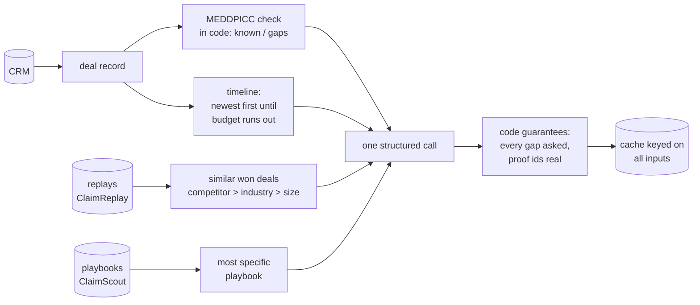

# ClaimPrep

**A two-minute brief before a sales call: the goal for the call, what to ask, which objections to
expect and how to answer them. Each answer is grounded in deals we already won.**

```
GET /api/deals/1/brief
```

```json
{
  "brief": {
    "call_goal": "Get the CFO into next week's security review.",
    "questions": [
      {"question": "Who signs off on a purchase like this?", "covers": ["economic_buyer"], "source": "model"},
      {"question": "Which reviews does a new vendor go through here?", "covers": ["paper_process"],
       "source": "checklist"}
    ],
    "objections": [
      {"objection": "Stackwise quoted 20% less", "response": "Cost of one bad-data incident vs. the gap...",
       "proof_deal_id": 2}
    ],
    "talk_track": ["..."], "risks": ["No economic buyer engaged yet"]
  },
  "checklist": {"known": ["pain", "champion", "competition"], "gaps": ["metrics", "economic_buyer", "..."]},
  "similar_wins": [{"deal_id": 2, "account": "Hollis Ledger", "turning_point": "..."}],
  "playbook": {"scope": "deals vs Stackwise", "headline": "Beat Stackwise on time to value."}
}
```

It also has a small web page for searching a deal and reading its brief.

Part of a set of four tools built around *what does a rep need to win the next call?*:
**ClaimReplay** (learn from each win) → **ClaimScout** (patterns across wins) → **ClaimPrep** (this repo)
→ **ClaimCoach** (chat coaching and objection role-play).

## How a brief is built



| Module | Responsibility |
|---|---|
| `qualification.py` | MEDDPICC framework: which elements are known, which are gaps, default questions |
| `evidence.py` | Similar won deals and the most specific matching playbook |
| `briefing.py` | Budgets the prompt sections, calls the model, applies code-side guarantees |
| `cache.py` | Brief cache keyed on every input |
| `service.py` | Cache-or-generate, one generation per deal at a time, response shape |
| `api.py` | FastAPI routes, optional API keys, web page |
| `crm.py`, `structured.py`, `budget.py`, `llm.py` | CRM access, validated JSON, token budgeting, model client |

### Design choices

- **The checklist is code, not a prompt suggestion.** Which MEDDPICC elements are unknown is computed
  from the CRM. After the model answers, any gap no question covers gets the checklist's default
  question, labelled `"source": "checklist"`. The model's three best questions are always kept.
- **Every proof is checked.** An objection response can cite the won deal that backs it. The id must
  be one of the deals the model was shown, or it is removed.
- **Budget by section.** The deal header and checklist are small. The playbook and similar wins are
  capped at a share of the budget. The timeline gets the rest, filled from the newest activity
  backwards, because last week matters more than the first discovery call. The prompt states how many
  older activities were left out.
- **A cache that is never stale.** The key covers the deal's content fingerprint, the evidence stores'
  version, the prompt version and the model. A new email or a fresh ClaimScout run means a new brief,
  and nothing else does. There is no TTL to tune.
- **One generation per deal.** A per-deal lock means two people opening the same deal at once trigger
  one model call.
- **Optional, constant-time API keys.** Several keys are supported so they can be rotated.

## Try it

ClaimPrep reads the CRM that ClaimReplay's `demo-data` command creates. It also uses ClaimReplay's and
ClaimScout's outputs when they exist.

```bash
pip install -e ".[dev]"
cp .env.example .env         # points at ../claim-replay/data/... by default
claim-prep                    # http://127.0.0.1:8100
```

Open the page and search for an open deal, or call `GET /api/deals/{id}/brief`.

## Development

```bash
pytest       # fixture CRM and stores, scripted fake model: no network or API key
ruff check .
```

**Author:** Vihas Adi
